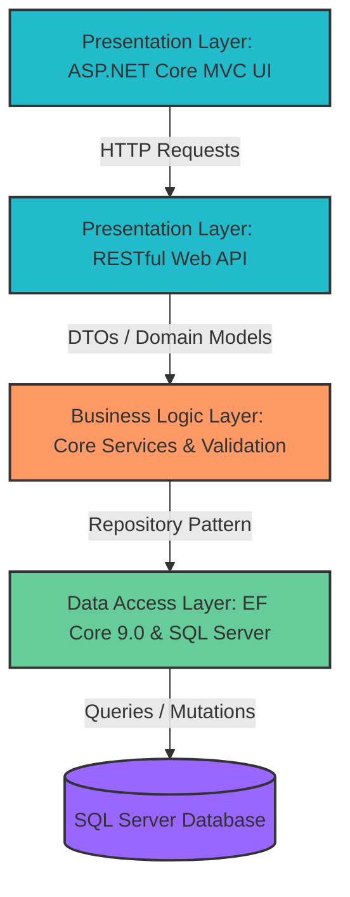

# MyShipping

“Full‑stack shipping management platform built with ASP.NET Core MVC, featuring secure user management, multi‑gateway payments, real‑time notifications, and analytics.”

**A full-stack shipping management platform with secure authentication, multi-gateway payment processing, and real-time notifications.**

## Overview

MyShipping is a shipping management system designed to streamline shipment tracking, payment processing, and user management. Built with **ASP.NET Core** and **Razor Views**, the platform provides a robust backend API and responsive web interface for shipping logistics management.

### Key Capabilities

✅ **User Management** - Secure authentication with ASP.NET Identity  
✅ **Payment Integration** - Multi-gateway support (PayPal, Stripe)  
✅ **Shipment Tracking** - Real-time shipment status monitoring  
✅ **Admin Dashboard** - Comprehensive management interface  
✅ **Email Notifications** - SendGrid integration for communications  
✅ **RESTful API** - WebApi backend for third-party integrations  
✅ **Localization** - Multi-language support (Arabic, English)  
✅ **Data Persistence** - Entity Framework Core with SQL Server

## 🏗️ Architecture & Project Structure

The project follows  **N-Tier Layered Architecture** pattern to enforce a strict separation of concerns, ensuring high scalability, maintainability, and testability.

### Architectural Blueprint



### Repository Layout

- **`UI/`**: Presentation layer handling the responsive Razor Views and localized web frontend.
- **`WebApi/`**: RESTful API endpoints powering secure business client and third-party communications.
- **`Business/`**: Core Business Logic Layer (BLL) housing state machine lifecycles and business workflows.
- **`DataAccessLayer/`**: Data Access Layer (DAL) managing Entity Framework Core 9.0 contexts, migrations, and repository implementations.
- **`Domains/`**: Shared entities, DTOs, and foundational data structures mapped across layers.
- **`WebApi.Tests/`**: Automated xUnit testing suites ensuring robust webhook and computation flows.

## 🚀 Tech Stack

### Backend

- **Framework:** ASP.NET Core 9.0
- **Language:** C# 13
- **Database:** SQL Server / Entity Framework Core
- **Authentication:** ASP.NET Identity with JWT
- **UI Framework:** Razor Views

### Payment Processing

- **PayPal Integration** - OAuth 2.0, webhook verification
- **Stripe Integration** - Payment processing & webhooks
- **Custom Gateway Factory** - Extensible payment architecture

### Third-Party Services

- **SendGrid** - Email notifications
- **Entity Framework Core** - ORM & migrations
- **xUnit** - Unit testing framework

### Front-End

- **Razor Views** - Server-side rendering
- **Bootstrap** - Responsive UI
- **JavaScript** - Client-side functionality
- **Localization** - Resource-based translations (Arabic, English)

---

## ⚡ Getting Started

### Prerequisites
- .NET 9 SDK
- SQL Server (LocalDB, Express or full instance)
- Optional: Stripe (test mode), PayPal (sandbox) and SendGrid accounts for payments and email

### 1. Clone and build
```bash
git clone https://github.com/sami-amara/MyShipping.git
cd MyShipping
dotnet build MyShipping.sln
```

### 2. Configure secrets
No credentials are stored in the repository. Set them with [User Secrets](https://learn.microsoft.com/aspnet/core/security/app-secrets) (development) or environment variables (use `__` instead of `:`, e.g. `PaymentGateways__Stripe__SecretKey`).

Run these for both the `UI` and `WebApi` projects (replace `<project>` with `UI` or `WebApi`):

```bash
dotnet user-secrets set "ConnectionStrings:ShippingConnection" "Server=localhost;Database=Shipping;Trusted_Connection=True;TrustServerCertificate=True" --project <project>
dotnet user-secrets set "JwtSettings:SecretKey" "<random string, 32+ characters>" --project <project>
dotnet user-secrets set "SendGrid:ApiKey" "<your key>" --project <project>
dotnet user-secrets set "PaymentGateways:Stripe:PublishableKey" "<pk_test_...>" --project <project>
dotnet user-secrets set "PaymentGateways:Stripe:SecretKey" "<sk_test_...>" --project <project>
dotnet user-secrets set "PaymentGateways:Stripe:WebhookSecret" "<whsec_...>" --project <project>
dotnet user-secrets set "PaymentGateways:PayPal:ClientId" "<sandbox client id>" --project <project>
dotnet user-secrets set "PaymentGateways:PayPal:ClientSecret" "<sandbox secret>" --project <project>
dotnet user-secrets set "PaymentGateways:PayPal:WebhookId" "<webhook id>" --project <project>
```

> `UI` and `WebApi` must use the **same** `JwtSettings:SecretKey`.

### 3. Run
`UI` applies all database migrations at startup (`Database.MigrateAsync()`) and creates the `Shipping` database if needed. **Start `UI` first**, then `WebApi`.

| Project | Default URL | Points to |
|---|---|---|
| `UI` | https://localhost:7065 | `ApiSettings:BaseUrl` → WebApi |
| `WebApi` | https://localhost:7228 | `ClientApp:BaseUrl` → UI |

### 4. First admin account
On first start `UI` creates the roles (`User`, `Admin`, `Reviewer`, `Operation`, `OperationManager`).
To create the first admin, set these secrets **before** the first run (the password must meet the Identity rules: 8+ characters, upper, lower, digit and symbol):
```bash
dotnet user-secrets set "SeedAdmin:Email" "<admin email>" --project UI
dotnet user-secrets set "SeedAdmin:Password" "<strong password>" --project UI
```
Sign in with it, then create other users and change roles from the Users dashboard.


---

## 🔗 Related Resources

- [Portfolio Repository](https://github.com/sami-amara/Portfolio) – Overview of my skills, CV, and other projects.
- [CV Repository](https://github.com/sami-amara/CV-SamiAmara) – Professional CV and career highlights.
- [LinkedIn Profile](https://www.linkedin.com/in/sami-amara-032b70416/) – Professional background and contact.
